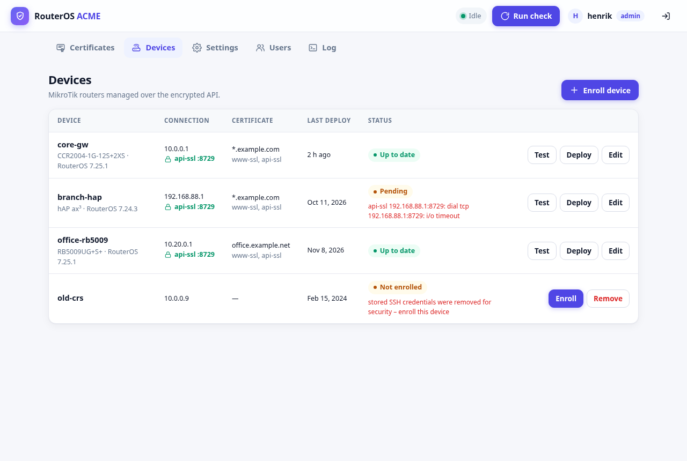
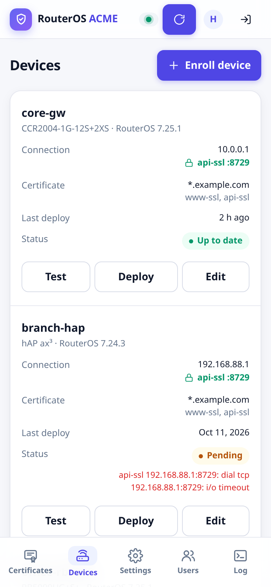

# routeros-acme

Let's Encrypt certificates for MikroTik RouterOS, managed from a web UI.
It is a lightweight replacement for running one
[`foorschtbar/routeros-letsencrypt`](https://hub.docker.com/r/foorschtbar/routeros-letsencrypt) container per router,
and is inspired by that project (see [Credits](#credits)).

- One small container (a static Go binary in a `scratch` image, about 10 MB) manages **many routers**.
- **Device enrollment**: an admin login is used once, to set up a restricted service account. After that all
  communication goes over the encrypted RouterOS API (api-ssl) with certificate pinning. No admin credentials are stored.
- DNS-01 validation through **Cloudflare**, so wildcards work and nothing has to be exposed to the internet.
- Certificates and routers are configured separately. One cert (e.g. `*.example.com`) can go to several routers and is issued only once.
- Runs on `linux/amd64`, `linux/arm64` and `linux/arm/v7` (Raspberry Pi etc).

## Screenshots

| Desktop | Phone |
|---|---|
|  |  |

More in [docs/screenshots](docs/screenshots/README.md). For an illustrated guide (features, flow, setup, security), open `docs/index.html` in a browser.

## Quick start

The image is published to the GitHub container registry for amd64, arm64 and arm/v7:
`ghcr.io/henrikvalstedt/routeros-acme`. The repository is private, so log in once with your GitHub account
first. You need read access to this repository and a token with the `read:packages` scope
(*GitHub → Settings → Developer settings → Personal access tokens → Tokens (classic)*):

```sh
docker login ghcr.io -u <your-github-username>        # password: the token
```

Then, with `docker-compose.yml` from this repository:

```sh
docker compose pull
docker compose up -d
docker compose logs | grep "Setup code"   # one-time code for creating the admin account
```

| Tag | What |
|---|---|
| `latest` | newest build of `main` |
| `1.2.3`, `1.2` | releases (git tags `v1.2.3`) |
| `sha-abc1234` | one specific commit |

To build from source instead, see [BUILD.md](BUILD.md).

Open `http://<host>:8080`. On first run you'll be asked for the setup code from the log and for the
username and password of the first **admin** account. Then:

1. **Settings**: enter your ACME e-mail and turn on *staging* while you test. Under **DNS accounts**, add a Cloudflare
   API token (*My Profile → API Tokens → Create Token → "Edit zone DNS"* template, i.e. `Zone:Read` + `DNS:Edit`).
   Add more tokens if your domains are in different Cloudflare accounts, or if you use one token per zone (see below).
2. **Certificates → Add**: list the domain names, one per line (`router.example.com`, `*.example.com`). The dialog
   shows which DNS account will validate each name.
3. **Devices → Enroll device**: enter the router address and an admin SSH login, confirm the device's
   SSH host key, review the changes, and enroll (see below). Use **Test** to check the connection; the certificate is deployed automatically.

Every *check interval* (default 12h) the app renews certificates that have fewer than *renew days* (default 30) left. It then pushes them to every enabled router that doesn't have the current one.

**Stopping and updating** (`docker stop`, Portainer "Update the stack") is a clean stop. New web requests are refused,
a running renewal or deploy finishes the certificate or router it's working on, the rest runs at the next start, and
the app exits with code 0. `docker-compose.yml` sets `stop_grace_period: 30s` because Docker's default is only 10
seconds. Use the same line in Portainer stacks.

**It runs unprivileged on its own.** The container starts as root only long enough to hand the data folder to user
65532, then switches to that user for good, with no privileges left. Data from older versions is handed over
automatically the first time. You don't need to set a user or change any file permissions. `docker-compose.yml` also
turns on a read-only root filesystem and drops all capabilities except the four needed for that first moment. Use the
same lines in Portainer stacks. Settings shows how your installation runs at the bottom of the page.

## Building

See **[BUILD.md](BUILD.md)** for the prerequisites (Docker 23+, buildx, Compose v2; no QEMU needed), build
commands for one or all architectures, pushing to a registry, and moving the image to a server without one.

```sh
docker buildx build --platform linux/amd64,linux/arm64,linux/arm/v7 -t routeros-acme:latest .
```

## Environment

| Variable         | Default  | Meaning |
|------------------|----------|---------|
| `ADMIN_USER`     | `admin`  | Only used on first run together with `ADMIN_PASSWORD` |
| `ADMIN_PASSWORD` | –        | If set on first run (no users yet), creates the admin account without the setup page. Ignored once users exist |
| `DATA_DIR`       | `/data`  | Config, ACME account, certificates |
| `LISTEN`         | `:8080`  | Web UI address |
| `TZ`             | UTC      | Time zone for logs |
| `SECRET_KEY_FILE`| –        | File with the key that encrypts stored secrets, e.g. a Docker secret. See [Hardened setup](#hardened-setup) |
| `SECRET_KEY`     | –        | The same key as a passphrase in a variable (visible in `docker inspect`, prefer `SECRET_KEY_FILE`). Default for both: a random key in `data/secret.key` |
| `OTP_FRESH_MINUTES` | `5`   | How long a 2FA code counts for sensitive actions before you're asked again. `0` = ask every time |
| `TRUSTED_PROXIES`| –        | Reverse proxy IPs/CIDRs (comma separated) or `private`. Only these may set `X-Forwarded-For` / `X-Forwarded-Proto` |
| `BASE_PATH`      | –        | Serve under a sub-path, e.g. `/certs` |
| `COOKIE_SECURE`  | `false`  | `true` always sets the Secure flag on the session cookie |

All other configuration lives in `/data/config.json` (mode 0600) and is edited through the UI.
Secrets (Cloudflare tokens, SMTP password, router passwords and keys) are stored encrypted and never sent back to the browser.

## DNS accounts (several Cloudflare tokens)

Let's Encrypt checks domain ownership with a temporary DNS record, so the app needs a Cloudflare API token that can edit
DNS for each zone. Add them under **Settings → DNS accounts**:

- **One account per token.** Use several when your domains live in different Cloudflare accounts, or when you prefer one
  narrowly scoped token per zone. Cloudflare is the only provider for now; the list is ready for more.
- **The token is checked when you save it.** The app asks Cloudflare which zones it can manage and lists them, so a
  wrong or under-privileged token is caught right away. Zone lists are refreshed daily, or with **Refresh**. Adding or
  changing a token asks for a fresh 2FA code, and tokens are stored encrypted.
- **Certificates pick the account automatically,** by the most specific zone that contains each name. One certificate
  can even mix zones from different accounts, for example `*.example.com` and `example.org`. You can also pin a
  certificate to one account in its dialog, which shows the account for each name as you type.
- **Names no account covers are refused when you save the certificate,** with the name in the message, instead of
  failing at renewal time.
- An account used by a pinned certificate can't be deleted until the certificate is changed.
- **Upgrading from 1.1 or earlier:** the single Cloudflare token from Settings becomes the DNS account "Cloudflare"
  automatically, and existing certificates keep working.

## E-mail: notifications, invitations, password reset

Configure SMTP under **Settings → E-mail & notifications** and use **Send test e-mail** to check it. The test uses
what's in the form, so you can test before saving. Nothing is stored until you click **Save e-mail settings**. With
the password field left empty, the saved password is used, but only for the same server and username.

| Security | Typical port | Notes |
|----------|--------------|-------|
| STARTTLS | 587 | Most providers (Gmail/Microsoft 365 need an app password) |
| TLS      | 465 | Implicit TLS |
| None     | 25  | Local relay only. Credentials are never sent unencrypted (except to localhost) |

Set **Public URL** to the address users open in their browser (e.g. `https://certs.example.com`, including any
`BASE_PATH`). E-mailed links use it.

**Notifications**: renewal failed, certificate expiring soon (within *warn days*, default 14, which only happens
when renewal keeps failing), deploy failed, certificate renewed, deployed to router. Each check sends at most
**one summary e-mail**. The same error for the same certificate or router is sent at most once per 24 hours,
and a success resets that. Recipients are all users who enabled *Send me notification e-mails* under
**My account** (click your name), plus the *extra recipients*.

**Invitations (enrollment)**: **Users → Invite by e-mail**, choose a role. The person gets a link (valid 72 hours)
where they pick their own username and password, and they're signed in right away. The link is also shown to the
admin, so it can be shared another way if e-mail isn't configured. Pending invitations can be revoked.
Admins can still create users directly with **Add user**.

**Forgot password**: shown on the login page once SMTP *and* the public URL are set. Users enter a username or
e-mail address and get a reset link (valid 1 hour, single use). Resetting signs the account out everywhere.
The answer is always the same, so it can't be used to find out which accounts exist, and it is rate-limited
per client.

Links carry the token after `#`, so it never reaches the server or proxy access logs. Only a SHA-256 hash of each
token is stored.

## Running behind a reverse proxy

TLS should be handled by your reverse proxy (nginx, Caddy, Traefik, NPM…). Configure three things:

1. **`TRUSTED_PROXIES`**: the proxy's address(es) as seen by the container. If they share a Docker network,
   this is the proxy container's IP or the network's subnet (e.g. `172.16.0.0/12`). `private` trusts all
   private ranges. `X-Forwarded-For` and `X-Forwarded-Proto` are **ignored from anyone else**, so clients can't
   fake their IP to get around the login lockout. The real client IP is used for the lockout and shown in the log.
2. **HTTPS**: when the proxy sends `X-Forwarded-Proto: https`, the session cookie is marked `Secure`
   (or set `COOKIE_SECURE=true`).
3. **Sub-path (optional)**: to serve at `https://example.com/certs/`, set `BASE_PATH=/certs`. It works whether
   or not the proxy strips the prefix. Serving on its own hostname (`https://certs.example.com/`) needs nothing.

Don't publish port 8080 to the network when using a proxy. Remove `ports:` and put both containers on the same
Docker network, or bind it to `127.0.0.1:8080:8080`.

**nginx**
```nginx
location /certs/ {                      # or "location /" on a dedicated hostname
    proxy_pass         http://routeros-acme:8080;   # keeps the /certs prefix (BASE_PATH=/certs)
    proxy_set_header   Host              $host;
    proxy_set_header   X-Forwarded-For   $proxy_add_x_forwarded_for;
    proxy_set_header   X-Forwarded-Proto $scheme;
}
```

**Caddy** (sets the forwarded headers automatically)
```
certs.example.com {
    reverse_proxy routeros-acme:8080
}
```

**Traefik** (labels on the routeros-acme service)
```yaml
labels:
  - traefik.enable=true
  - traefik.http.routers.rosacme.rule=Host(`certs.example.com`)
  - traefik.http.routers.rosacme.entrypoints=websecure
  - traefik.http.routers.rosacme.tls=true
  - traefik.http.services.rosacme.loadbalancer.server.port=8080
```

**Not sure which address to trust?** The app notices when requests carry a proxy's headers from an address that
isn't trusted. Admins then see a warning at the top of **Settings** with the exact `TRUSTED_PROXIES=…` value, and the
log says the same once. After fixing it, sign-in log lines show your real client address instead of the proxy's.

Proxies in **host-network mode** (for example Nginx Proxy Manager on a NAS) reach the container through Docker's
gateway, such as `172.29.20.1`, which can change if the stack's network is recreated. Publish the port on localhost
only and trust the Docker range:

```yaml
    ports:
      - "127.0.0.1:8080:8080"        # only the host (the proxy) can connect
    environment:
      TRUSTED_PROXIES: 172.29.0.0/16  # the gateway range the proxy arrives from
```

## Hardened setup

The quick start works without any of this. It is for keeping the encryption key out of backups of the data folder.

Stored secrets (Cloudflare tokens, the SMTP password, device service passwords, 2FA secrets) are encrypted. By default the
key is `data/secret.key`, right next to `config.json`. A backup or copy of the whole data folder then holds both the lock
and the key. With `SECRET_KEY_FILE` the key lives outside the data folder, for example as a Docker secret:

1. **Create a key file outside the data folder**, readable by root only. Either generate a new one:
   ```sh
   openssl rand -base64 32 > /share/Container/routeros-acme.key   # any path outside the data folder
   chmod 400 /share/Container/routeros-acme.key
   ```
   or move the existing key out: `mv data/secret.key /share/Container/routeros-acme.key`.
2. **Point the container at it** (in `docker-compose.yml` or the Portainer stack; the lines are there, commented out):
   ```yaml
   services:
     routeros-acme:
       environment:
         SECRET_KEY_FILE: /run/secrets/routeros_acme_key
       secrets:
         - routeros_acme_key
   secrets:
     routeros_acme_key:
       file: /share/Container/routeros-acme.key   # absolute path on the Docker host
   ```
3. **Restart.** The log shows what happened:
   ```
   encryption key: SECRET_KEY_FILE
   re-encrypted 7 stored secret(s) with the key from SECRET_KEY_FILE     (only with a new key)
   removed secret.key from the data folder: the key from SECRET_KEY_FILE is used now
   ```

The container reads the key while it is still root, so the file can stay readable by root only. **Back up the key file
separately from the data folder.** Without it the stored secrets can't be decrypted.

**Going back to the default:** copy the key file into the data folder as `secret.key`, then remove `SECRET_KEY_FILE`
and the secret from the stack.

**Safety checks.** At every start the key is checked against all stored secrets. The app refuses to start, and says
why, when the key file is missing, when it is the wrong key, or when `SECRET_KEY_FILE` was removed without copying the
key back. It never creates a new key over encrypted data.

**Key file format.** A file of exactly 32 bytes is used as is (that is what the app generates). Anything else is a
passphrase of at least 16 characters, without surrounding spaces or line breaks.

**Key lost for good.** Stop the container and remove the secrets that can't be decrypted any more:
```sh
docker compose stop
docker compose run --rm routeros-acme -forget-secrets
docker compose start
```
The log lists what was removed. Enroll the listed devices again, enter DNS tokens and the SMTP password again, and the
listed users set up 2FA again at their next sign-in. Everything else is kept: certificates, devices' settings, users and
passwords.

**Other ways to run it:**
- `user: "1000:1000"` (your NAS user, PUID style) also works. The app then never runs as root, but the data folder must
  already belong to that user, and the key file must be readable by it.
- On a share that refuses ownership changes (NFS with root squash), the app keeps running as root and the log says
  why. Nothing breaks.

## Users and roles

| Role     | Can do |
|----------|--------|
| `admin`  | Everything: settings, certificates, routers, deploy/renew, and user management (**Users** tab). Must use 2FA |
| `viewer` | See status, certificates, routers, settings and the log. Cannot change or trigger anything |

- On first run the UI shows a setup page that creates the first admin. It needs the one-time
  **setup code** printed in the container log, so nobody else on the network can claim the instance before you do.
- Every user can change their own password, e-mail address and notification setting (click your name in the header).
- Users can also be invited by e-mail and choose their own username and password (see above).
- You can't delete or demote the last admin, and you can't delete yourself.
- Changing a user's password signs them out everywhere. Deleting a user takes effect immediately, and so does a role change.
- Sessions use an HttpOnly, SameSite=Strict cookie and last 7 days. They are kept in memory, so everyone signs in again after a container restart.
- After 5 failed logins from one client IP address, logins from that address are blocked for 5 minutes. Behind a proxy this is the real client IP (see `TRUSTED_PROXIES`).
- Lost the only admin password? Use *Forgot password?* if e-mail is set up. Otherwise stop the container and remove the `"users"` entries from `data/config.json`.
  On the next start you get a new setup code, or you can set `ADMIN_PASSWORD`.

## Two-factor authentication

Every **admin must use two-factor authentication** (TOTP codes from an authenticator app, such as Google or Microsoft
Authenticator, Authy, 1Password or Bitwarden). Admins control routers, the Cloudflare DNS token and other users, so a
password alone isn't enough.

- **Setup:** right after first-run setup, an invitation, or being made admin, the UI asks you to scan a QR code (or type
  the key) and confirm with a code. Nothing else is possible until 2FA is on. You then get **10 recovery codes**, shown
  once. Each signs you in once if you lose your phone. Copy or download them before continuing.
- **Signing in:** password, then the 6-digit code (or a recovery code). Each code works only once, and wrong codes are
  rate-limited like wrong passwords.
- **Sensitive actions ask for a fresh code** ("Confirm it's you"), even when you're signed in: enrolling a device,
  removing a device with cleanup, adding or changing a Cloudflare token, a new SMTP password, switching off "2FA for everyone", creating or
  promoting an admin, changing another user's password, inviting an admin, deleting a user, resetting someone's 2FA,
  and new recovery codes. A code counts for 5 minutes (`OTP_FRESH_MINUTES`).
- **Viewers:** 2FA is optional (*My account → Set up two-factor authentication*). Settings has a switch to
  **require it for everyone**.
- **Lost phone:** sign in with a recovery code, then make new codes under *My account*. An admin can also **Reset 2FA**
  for another user (Users → Edit); that user sets it up again at the next sign-in.
- **The only admin lost both phone and recovery codes:** stop the container and reset it from the command line. The
  data directory is locked while the app runs, so this only works when it's stopped:
  ```sh
  docker compose stop
  docker compose run --rm routeros-acme -reset-2fa <username>
  docker compose start
  ```
- The 2FA secret is stored encrypted (like router secrets), and recovery codes only as hashes.

### Passkeys (optional)

On top of the code, every user can add **passkeys** (Face ID, Touch ID, a fingerprint, Windows Hello, a phone or a
security key) under *My account → Passkeys*.

- **Sign in with a passkey** replaces password *and* code: one tap plus Face ID or a fingerprint. Passkeys always
  require that check on the device, and they're phishing-proof, because they only work on the real site address.
- **"Confirm it's you"** accepts a passkey instead of a code.
- **The code stays the foundation and the fallback.** A passkey can only be added while 2FA is on. Adding or removing
  one needs a fresh code or passkey. Turning 2FA off, an admin's *Reset 2FA* and `-reset-2fa` also remove passkeys.
- **Passkeys need HTTPS and a host name,** for example `https://certs.example.com` through a reverse proxy (see below).
  They don't work on `http://192.168.x.x:8080`; the UI explains this, and password plus code works there as always. A
  passkey belongs to the address it was created on, so if the address changes, add the passkeys again.
- The reverse proxy must pass the original host name on (`Host` header). Caddy, Traefik and Nginx Proxy Manager do this
  by default; for plain nginx use `proxy_set_header Host $host;` as in the example below.

## Device enrollment

Devices are **enrolled** once instead of storing an SSH login. Requires **RouterOS 7**.

1. **Connect**: enter the device address and an **admin** SSH login (password or key). The app reads identity, model,
   version and api-ssl status, and shows the device's **SSH host key fingerprint**.
2. **Review & confirm**: compare the fingerprint with the one your SSH client shows and confirm it. The page lists
   exactly what will change on the device.
3. **Enroll**: over that single SSH session the app:
   - secures **api-ssl** with a certificate. If api-ssl already has one, it is kept; otherwise a self-signed
     `routeros-acme-api` certificate is installed. Either way its **SHA-256 fingerprint is pinned**, so the app only
     ever talks to that device (no CA is needed, and IP addresses work);
   - enables api-ssl on the chosen port. No other services are touched;
   - creates group **`routeros-acme`** with policies `api,read,write,ftp,sensitive,password`. Everything else is denied
     (ssh, winbox, web, telnet, local console, policy/user management, reboot, sniff, romon, rest-api);
   - creates user **`routeros-acme`** in that group with a **random 256-bit password that no person sees**, restricted
     to the app's address (detected automatically, editable, or empty for any);
   - **verifies** the login over api-ssl. If that fails, the user is removed again.

**The admin login is never stored or logged.** Afterwards everything goes through api-ssl:

- **Deploy**: the chain is uploaded and imported. The private key is uploaded **encrypted with a one-time passphrase**,
  because RouterOS writes `/file add` contents to its system log. The passphrase is only sent in the import command, which isn't logged.
  The cert is assigned to www-ssl/api-ssl, extra commands run as a temporary script, and older certificates from
  this app plus the uploaded files are removed. If api-ssl itself gets the new certificate, the pin moves with it.
- **Password rotation**: the service account password is changed automatically every 30 days (or with *Rotate password now*).
  The new password is saved before it is applied, so a crash can't lock the app out.
- **Secrets at rest**: the service password is stored AES-256-GCM encrypted. The key is in `data/secret.key`, or outside the
  data folder with `SECRET_KEY_FILE` (see [Hardened setup](#hardened-setup)).
- **Remove**: forget the device, or also delete the service account (and group) from it with a one-time admin login.
- **Re-enroll** when the device's api-ssl certificate was changed by someone else (the pin no longer matches), the
  address changed, or the encryption key was lost (see `-forget-secrets` under [Hardened setup](#hardened-setup)).

RouterOS's API has no key-based login, so "passwordless" here means a machine password that no person ever sees,
that is limited to one source address and API-only rights, and that rotates automatically.

**Extra commands** examples (RouterOS script, `{{cert}}` = certificate name on the device):

```
/interface sstp-server server set certificate={{cert}}
/ip hotspot profile set [find] ssl-certificate={{cert}}
/interface ovpn-server server set [find] certificate={{cert}}
```

Make sure the container can reach the device's api-ssl port, and its SSH port during enrollment. If api-ssl uses
`available-from`, it must include the container's address.

## Security notes

- The container serves plain HTTP. Keep it on a trusted network or put it behind a reverse proxy with TLS (see above).
- Use Cloudflare tokens scoped to just the zones they're for (one DNS account per token).
- The app runs as an unprivileged user with no capabilities, on a read-only root filesystem (see Quick start).
- Keep the encryption key out of data folder backups with `SECRET_KEY_FILE` ([Hardened setup](#hardened-setup)).
- Every build runs `govulncheck`, and once a week as well. Dependabot proposes updates for Go modules, the base image and
  GitHub Actions weekly.

## Development

```sh
go test ./...          # auth/roles, invite/reset via fake SMTP, notifications, proxy, API encoding, secrets

# full device lifecycle against a real RouterOS 7 (e.g. a CHR VM):
ROS_HOST=127.0.0.1 ROS_SSH_PORT=2222 ROS_API_PORT=8729 ROS_USER=admin ROS_PASS=... go test -run Real -v .
go run .               # DATA_DIR=./data LISTEN=:8080
# CLOUDFLARE_API_URL=http://127.0.0.1:9999  points the app at a fake Cloudflare API (testing only)
```

## Credits

RouterOS ACME is inspired by
[**foorschtbar/routeros-letsencrypt**](https://hub.docker.com/r/foorschtbar/routeros-letsencrypt) by
[foorschtbar](https://github.com/foorschtbar): a container that gets Let's Encrypt certificates for a MikroTik router
and installs them on it. It inspired the core features of this project: DNS validation, uploading the certificate
to the router, assigning it to services such as `www-ssl` and `api-ssl`, and replacing the previous certificate.
Thank you!

RouterOS ACME is an independent project, written from scratch, and is not affiliated with or endorsed by
foorschtbar. No code was copied.

## License

RouterOS ACME is released under the [MIT License](LICENSE). You may use, change and share it, also commercially,
as long as the copyright notice and the license text stay with it.

It is built on open-source libraries, among them [lego](https://github.com/go-acme/lego) (MIT),
[go-webauthn](https://github.com/go-webauthn/webauthn) (BSD-3-Clause), [pkg/sftp](https://github.com/pkg/sftp)
(BSD-2-Clause), [go-pkcs12](https://github.com/SSLMate/go-pkcs12) (BSD-3-Clause), the Go `golang.org/x` packages
(BSD-3-Clause) and Go itself (BSD-3-Clause). The license of every library compiled into the program is included
in the container image at `/licenses/THIRD_PARTY_LICENSES.txt`. Read it with:

```sh
docker cp routeros-acme:/licenses/THIRD_PARTY_LICENSES.txt .
```

`scripts/third-party-licenses.sh` creates that file during the image build, so it always matches the exact versions.
